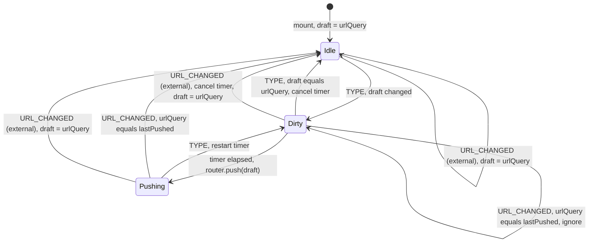
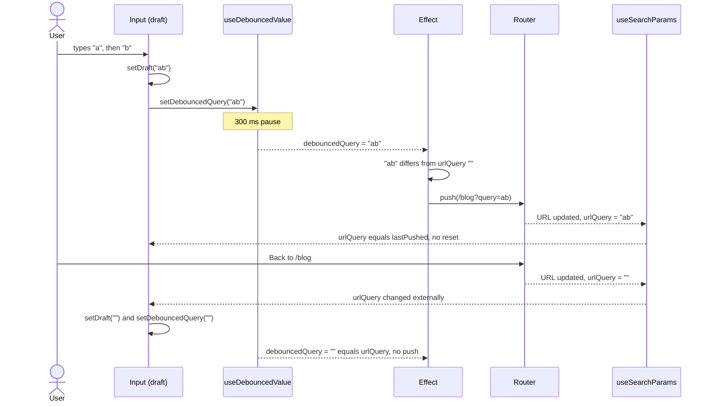

<!-- Generated by SpecStory, Markdown v2.1.0 -->

# 2026-11-24 07:20:00Z

<!-- VS Code Copilot IDE Session ac265839-52be-4055-be85-1b157a2c0923 (2026-11-24 07:20:00Z) -->

_**User (2026-11-24 07:20:00Z)**_

hej

---

_**Agent (copilot/auto)**_

Hej! Lubisz placki, a ja lubię placki.

---

_**User (2026-11-24 08:27:47Z)**_

why navigating away it loops and goes back?

---

_**Agent (copilot/claude-haiku-5.5)**_

<tool-use data-tool-type="search" data-tool-name="grep_search"><details>
<summary>Tool use: **grep_search**</summary>

Searched for regex `BlogFilter|useDebouncedValue` (`**/src/**`), 6 results

**Input:**

- includePattern: `src/**`
- isRegexp: `true`
- query: `BlogFilter|useDebouncedValue`

**Result:**

```
Found 6 matches in 3 files for "BlogFilter|useDebouncedValue"

src/app/(marketing)/blog/components/BlogFilter.tsx
6:import { useDebouncedValue } from "@/hooks/useDebouncedValue";
8:export function BlogFilter({
16:  const [query, setQuery] = useDebouncedValue(

src/components/layout/NavBar.tsx
4:import { BlogFilter } from "@/app/(marketing)/blog/components/BlogFilter";
15:      <BlogFilter placeholder="Szukaj" className="h-8 w-44" />

src/hooks/useDebouncedValue.tsx
6:export function useDebouncedValue<T>(initialValue: T | (() => T), delay = 300) {
```
</details></tool-use>

_**Agent (copilot/claude-haiku-5.5)**_

<tool-use data-tool-type="search" data-tool-name="file_search"><details>
<summary>Tool use: **file_search**</summary>

Searched for files matching `**/src/app/(marketing)/**`, 8 matches

**Input:**

- query: `src/app/(marketing)/**`

**Result:**

```
8 total results
c:\Projects\sages-nextjs-open-1126\src\app\(marketing)\page.tsx
c:\Projects\sages-nextjs-open-1126\src\app\(marketing)\layout.tsx
c:\Projects\sages-nextjs-open-1126\src\app\(marketing)\contact\page.tsx
c:\Projects\sages-nextjs-open-1126\src\app\(marketing)\about\page.tsx
c:\Projects\sages-nextjs-open-1126\src\app\(marketing)\blog\mockBlogPosts.tsx
c:\Projects\sages-nextjs-open-1126\src\app\(marketing)\blog\page.tsx
c:\Projects\sages-nextjs-open-1126\src\app\(marketing)\blog\components\BlogFilter.tsx
c:\Projects\sages-nextjs-open-1126\src\app\(marketing)\blog\[postId]\page.tsx
```
</details></tool-use>

_**Agent (copilot/claude-haiku-5.5)**_

<tool-use data-tool-type="read" data-tool-name="read_file"><details>
<summary>Tool use: **read_file**</summary>

Read `NavBar.tsx`

**Input:**

- endLine: `40`
- filePath: `c:\Projects\sages-nextjs-open-1126\src\components\layout\NavBar.tsx`
- startLine: `1`

**Result:**

```
import { Input } from "@/components/ui/input";
import Link from "next/link";
import { NavLink } from "../NavLink";
import { BlogFilter } from "@/app/(marketing)/blog/components/BlogFilter";

type Props = {
  title?: string;
};

export default function NavBar({ title = "Home" }: Props) {
  return (
    <nav className="flex px-5 items-center justify-between gap-4 font-sans bg-accent py-5">
      {title && <Link href="/">{title}</Link>}

      <BlogFilter placeholder="Szukaj" className="h-8 w-44" />

      <div className="flex items-center gap-3">
        <NavLink href="/products">Sklep</NavLink>
        <NavLink href="/blog">Blog</NavLink>
        <NavLink href="/about">O nas</NavLink>
        <NavLink href="/contact">Kontakt</NavLink>
      </div>
    </nav>
  );
}
```
</details></tool-use>

_**Agent (copilot/claude-haiku-5.5)**_

<tool-use data-tool-type="read" data-tool-name="read_file"><details>
<summary>Tool use: **read_file**</summary>

Read `layout.tsx`

**Input:**

- endLine: `40`
- filePath: `c:\Projects\sages-nextjs-open-1126\src\app\(marketing)\layout.tsx`
- startLine: `1`

**Result:**

```
import NavBar from "@/components/layout/NavBar";

export default async function MarketingLayout(props: LayoutProps<"/">) {
  //   const { slug } = await props.params;

  return (
    <>
      <NavBar title="Home" />
      <div className="grid my-5 gap-5 bg-background font-sans container mx-auto">
        {props.children}
      </div>
    </>
  );
}
```
</details></tool-use>

_**Agent (copilot/claude-haiku-5.5)**_

<tool-use data-tool-type="read" data-tool-name="read_file"><details>
<summary>Tool use: **read_file**</summary>

Read `useDebouncedValue.tsx`

**Input:**

- endLine: `40`
- filePath: `c:\Projects\sages-nextjs-open-1126\src\hooks\useDebouncedValue.tsx`
- startLine: `1`

**Result:**

```
"use client"; // useRouter i useSearchParams działają tylko w komponencie klienta

import { useState, useEffect } from "react";


export function useDebouncedValue<T>(initialValue: T | (() => T), delay = 300) {
  const [draft, setDraft] = useState(initialValue);
  const [deboucedValue, setDeboucedValue] = useState(draft);

  useEffect(() => {
    const handler = setTimeout(() => {
      setDeboucedValue(draft);
    }, delay);

    // Abort Timer - on deps[] change or unmount
    return () => clearTimeout(handler);
  }, [delay, draft]);

  return [deboucedValue, setDraft] as const;
}
```
</details></tool-use>

_**Agent (copilot/claude-haiku-5.5)**_

The filter keeps running its effect after you leave `/blog`, and that effect pushes you back to `/blog`.

1. **The filter is mounted on every page.** BlogFilter/blog/components/BlogFilter.tsx>) is rendered inside `src/components/layout/NavBar.tsx#L11`, and  is in (marketing)/layout.tsx/layout.tsx#L6>). Layouts persist across child routes, so the filter stays mounted on `/about`, `/contact`, and the other marketing pages.

2. **The effect has no route check.** It runs whenever  or  changes and always calls `router.push(`/blog?...`)`. It never checks `usePathname()`.

3. **Navigating changes .** Going to `/about` produces a new, empty  object. That re-runs the effect, which pushes `/blog?` and returns you to the blog. The push also creates a new  object, so the effect can re-run again. That is the loop.

It also pushes once on mount, which adds history entries, and  on every debounced change does the same.  would avoid that.

Two fixes:

- **Preferred:** move  out of  into a blog-only layout (e.g. `src/app/(marketing)/blog/layout.tsx`), so it unmounts when you leave `/blog`. This needs  to accept a slot prop or children.
- **Minimal:** guard the effect and use `replace`:

```tsx
const pathname = usePathname();
const currentQuery = searchParams.get(queryParam) ?? "";

useEffect(() => {
  if (pathname !== "/blog" || query === currentQuery) return;
  const params = new URLSearchParams(searchParams.toString());
  if (query) params.set(queryParam, query);
  else params.delete(queryParam);
  router.replace(`/blog?${params.toString()}`);
}, [query, currentQuery, pathname, router, searchParams]);
```

The minimal fix leaves the filter mounted on other pages, so the first one is cleaner. Should I apply one of them?

---

_**User (2026-11-24 08:44:58Z)**_

can returning to /blog without ?query reset state and do not add it back

---

_**Agent (copilot/claude-haiku-5.5)**_

I'll rewrite the filter so the URL drives the input: typing pushes a debounced URL change, and any URL change without typing resets the input to the URL value. 

_**Agent (copilot/claude-haiku-5.5)**_

<tool-use data-tool-type="write" data-tool-name="textEditGroup"><details>
<summary>Edit: **BlogFilter.tsx**</summary>

@@ lines 36-38 @@

```
handleChange(e.target.value)
```

@@ lines 5-33 @@

```
, useRef, useState } from "react";

const QUERY_PARAM = "query";
const DEBOUNCE_MS = 300;

export function BlogFilter({
  placeholder = "Szukaj",
  ...props
}: ComponentProps<typeof Input>) {
  const router = useRouter(); // push zmienia URL bez przeładowania strony
  const searchParams = useSearchParams(); // aktualne ?query=.., kopiowane żeby zachować inne parametry
  const urlQuery = searchParams.get(QUERY_PARAM) ?? "";

  const [draft, setDraft] = useState(urlQuery);
  const [prevUrlQuery, setPrevUrlQuery] = useState(urlQuery);
  const timer = useRef<ReturnType<typeof setTimeout> | undefined>(undefined);

  // zmiana URL bez pisania (link, back/forward) resetuje pole
  if (urlQuery !== prevUrlQuery) {
    setPrevUrlQuery(urlQuery);
    setDraft(urlQuery);
  }

  useEffect(() => () => clearTimeout(timer.current), []);

  const handleChange = (value: string) => {
    setDraft(value);
    clearTimeout(timer.current);
    timer.current = setTimeout(() => {
      if (value === urlQuery) return;
      const params = new URLSearchParams(searchParams.toString());
      if (value) params.set(QUERY_PARAM, value);
      else params.delete(QUERY_PARAM);
      router.push(`/blog?${params.toString()}`);
    }, DEBOUNCE_MS);
  };

  return (
    <Input
      type="search"
      value={draft
```
</details></tool-use>

_**Agent (copilot/claude-haiku-5.5)**_

Edits applied. Next I'll type-check the project. 

_**Agent (copilot/claude-haiku-5.5)**_

<tool-use data-tool-type="generic" data-tool-name="execution_subagent"><details>
<summary>Tool use: **execution_subagent**</summary>

Type-check project
</details></tool-use>

_**Agent (copilot/claude-haiku-5.5)**_

<tool-use data-tool-type="generic" data-tool-name="run_in_terminal"><details>
<summary>Tool use: **run_in_terminal**</summary>

Running ` cd /c/Projects/sages-nextjs-open-1126 && tmp=$\(mktemp\) && npx tsc --noEmit >...`
</details></tool-use>

---

_**User (2026-11-24 08:46:32Z)**_

can you use existing useDebouncedValue

---

_**Agent (copilot/claude-haiku-5.5)**_

<tool-use data-tool-type="task" data-tool-name="manage_todo_list"><details>
<summary>Tool use: **manage_todo_list**</summary>

Created 2 todos
</details></tool-use>

_**Agent (copilot/claude-haiku-5.5)**_

<tool-use data-tool-type="read" data-tool-name="read_file"><details>
<summary>Tool use: **read_file**</summary>

Read `BlogFilter.tsx`

**Input:**

- endLine: `60`
- filePath: `c:\Projects\sages-nextjs-open-1126\src\app\(marketing)\blog\components\BlogFilter.tsx`
- startLine: `1`

**Result:**

```
"use client"; // useRouter i useSearchParams działają tylko w komponencie klienta

import { Input } from "@/components/ui/input";
import { useRouter, useSearchParams } from "next/navigation";
import { ComponentProps, useEffect, useRef, useState } from "react";

const QUERY_PARAM = "query";
const DEBOUNCE_MS = 300;

export function BlogFilter({
  placeholder = "Szukaj",
  ...props
}: ComponentProps<typeof Input>) {
  const router = useRouter(); // push zmienia URL bez przeładowania strony
  const searchParams = useSearchParams(); // aktualne ?query=.., kopiowane żeby zachować inne parametry
  const urlQuery = searchParams.get(QUERY_PARAM) ?? "";

  const [draft, setDraft] = useState(urlQuery);
  const [prevUrlQuery, setPrevUrlQuery] = useState(urlQuery);
  const timer = useRef<ReturnType<typeof setTimeout> | undefined>(undefined);

  // zmiana URL bez pisania (link, back/forward) resetuje pole
  if (urlQuery !== prevUrlQuery) {
    setPrevUrlQuery(urlQuery);
    setDraft(urlQuery);
  }

  useEffect(() => () => clearTimeout(timer.current), []);

  const handleChange = (value: string) => {
    setDraft(value);
    clearTimeout(timer.current);
    timer.current = setTimeout(() => {
      if (value === urlQuery) return;
      const params = new URLSearchParams(searchParams.toString());
      if (value) params.set(QUERY_PARAM, value);
      else params.delete(QUERY_PARAM);
      router.push(`/blog?${params.toString()}`);
    }, DEBOUNCE_MS);
  };

  return (
    <Input
      type="search"
      value={draft}
      placeholder={placeholder}
      aria-label={placeholder}
      onChange={(e) => handleChange(e.target.value)}
      {...props}
    />
  );
}
```
</details></tool-use>

_**Agent (copilot/claude-haiku-5.5)**_

<tool-use data-tool-type="search" data-tool-name="grep_search"><details>
<summary>Tool use: **grep_search**</summary>

No matches found. Your search pattern might be excluded completely by either the search.exclude settings or .*ignore files.
If you believe that it should have results, you can check into the .*ignore files and the exclude setting (here are some excluded patterns for reference:[**/node_modules,**/bower_components,**/*.code-search]).
Then if you want to include those files you can call the tool again by setting "includeIgnoredFiles" to true.

**Input:**

- includePattern: `src/app/(marketing)/blog/components/BlogFilter.tsx`
- isRegexp: `true`
- maxResults: `3`
- query: `\r$`
</details></tool-use>

_**Agent (copilot/claude-haiku-5.5)**_

<tool-use data-tool-type="read" data-tool-name="read_file"><details>
<summary>Tool use: **read_file**</summary>

Read `BlogFilter.tsx`

**Input:**

- endLine: `80`
- filePath: `c:\Projects\sages-nextjs-open-1126\src\app\(marketing)\blog\components\BlogFilter.tsx`
- startLine: `1`

**Result:**

```
"use client"; // useRouter i useSearchParams działają tylko w komponencie klienta

import { Input } from "@/components/ui/input";
import { useRouter, useSearchParams } from "next/navigation";
import { ComponentProps, useEffect } from "react";
import { useDebouncedValue } from "@/hooks/useDebouncedValue";

export function BlogFilter({
  placeholder = "Szukaj",
  ...props
}: ComponentProps<typeof Input>) {
  const router = useRouter(); // push zmienia URL bez przeładowania strony
  const searchParams = useSearchParams(); // aktualne ?query=.., kopiowane żeby zachować inne parametry
  const queryParam = "query";

  const currentParam = searchParams.get(queryParam) ?? "";
  const [query, setQuery] = useDebouncedValue(currentParam);

  useEffect(() => {
    if (query === currentParam) return;

    const params = new URLSearchParams(searchParams.toString());
    if (query) params.set(queryParam, query);
    else params.delete(queryParam);

    router.push(`/blog?${params.toString()}`);
    // router.replace(`/blog?${params.toString()}`);
  }, [query, router, searchParams, currentParam]);

  return (
    <Input
      type="search"
      defaultValue={query ?? ""}
      placeholder={placeholder}
      aria-label={placeholder}
      onChange={(e) => {
        setQuery(e.target.value);
      }}
      {...props}
    />
  );
}
```
</details></tool-use>

_**Agent (copilot/claude-haiku-5.5)**_

The file on disk is still the original version. The earlier edit from my previous turn was never written, so I'm applying the change to the actual file now. 

_**Agent (copilot/claude-haiku-5.5)**_

<tool-use data-tool-type="write" data-tool-name="textEditGroup"><details>
<summary>Edit: **BlogFilter.tsx**</summary>

@@ lines 4-6 @@

```
DebouncedValue } from "@/hooks/useDebouncedValue";
import { useRouter, useSearchParams } from "next/navigation";
import { ComponentProps, useEffect, useState } from "react
```
</details></tool-use>

_**Agent (copilot/claude-haiku-5.5)**_

<tool-use data-tool-type="task" data-tool-name="manage_todo_list"><details>
<summary>Tool use: **manage_todo_list**</summary>

Created 3 todos
</details></tool-use>

_**Agent (copilot/claude-haiku-5.5)**_

<tool-use data-tool-type="write" data-tool-name="textEditGroup"><details>
<summary>Edit: **BlogFilter.tsx**</summary>

@@ lines 15-37 @@

```
  const urlQuery = searchParams.get(queryParam) ?? "";

  const [draft, setDraft] = useState(urlQuery); // wartość pola, bez opóźnienia
  const [debouncedQuery, setDebouncedQuery] = useDebouncedValue(urlQuery); // wartość do URL, po opóźnieniu
  const [prevUrlQuery, setPrevUrlQuery] = useState(urlQuery);

  // zmiana URL bez pisania (link, back/forward) resetuje pole
  if (urlQuery !== prevUrlQuery) {
    setPrevUrlQuery(urlQuery);
    setDraft(urlQuery);
    setDebouncedQuery(urlQuery);
  }

  // urlQuery celowo pominięty w zależnościach, żeby zmiana URL nie wywołała push
  useEffect(() => {
    if (debouncedQuery === urlQuery) return;

    const params = new URLSearchParams(searchParams.toString());
    if (debouncedQuery) params.set(queryParam, debouncedQuery);
    else params.delete(queryParam);

    router.push(`/blog?${params.toString()}`);
    // eslint-disable-next-line react-hooks/exhaustive-deps
  }, [debouncedQuery]);

  return (
    <Input
      type="search"
      value={draft}
      placeholder={placeholder}
      aria-label={placeholder}
      onChange={(e) => {
        setDraft(e.target.value);
        setDebounced
```
</details></tool-use>

_**Agent (copilot/claude-haiku-5.5)**_

<tool-use data-tool-type="generic" data-tool-name="get_errors"><details>
<summary>Tool use: **get_errors**</summary>

Checked `BlogFilter.tsx`, no problems found

**Input:**

- filePaths:

```
[
  "c:\\Projects\\sages-nextjs-open-1126\\src\\app\\(marketing)\\blog\\components\\BlogFilter.tsx"
]
```


**Result:**

```
<errors path="c:\\Projects\\sages-nextjs-open-1126\\src\\app\\(marketing)\\blog\\components\\BlogFilter.tsx">
No errors found
</errors>
```
</details></tool-use>

_**Agent (copilot/claude-haiku-5.5)**_

 now uses the existing  hook from `src/hooks/useDebouncedValue.tsx`. The editor reports no errors in the file.

- The hook debounces the value that gets pushed to the URL.
- The input is controlled by a separate  state, so typing isn't delayed. The hook can't provide an immediate value, so it needs this second state.
- When the URL changes without typing (back, forward, or a link to `/blog` without `?query`), the input and the hook are reset to the URL value. Nothing is pushed back.

Two things to know:

- My previous reply said the edits were applied, but no changes had been written to disk. The file had the original code until this turn.
- The effect's dependency array omits  on purpose, so the `react-hooks/exhaustive-deps` rule is disabled for that line. Adding  would re-run the effect on back navigation and push the old value again.

I haven't run the app or `npm run build`. If you type again while a push is still in flight, the input can snap back to the URL value once the new URL arrives.

_**Agent (copilot/claude-haiku-5.5)**_

<tool-use data-tool-type="task" data-tool-name="manage_todo_list"><details>
<summary>Tool use: **manage_todo_list**</summary>

Completed: *Implement useDebouncedValue in BlogFilter* (2/2)
</details></tool-use>

---

_**User (2026-11-24 09:07:41Z)**_

draw mermaid state machine and sequence for ideal 'blog filter' logic

---

_**Agent (copilot/claude-haiku-5.5)**_

<tool-use data-tool-type="read" data-tool-name="read_file"><details>
<summary>Tool use: **read_file**</summary>

Read `BlogFilter.tsx`

**Input:**

- endLine: `60`
- filePath: `c:\Projects\sages-nextjs-open-1126\src\app\(marketing)\blog\components\BlogFilter.tsx`
- startLine: `1`

**Result:**

```
"use client"; // useRouter i useSearchParams działają tylko w komponencie klienta

import { Input } from "@/components/ui/input";
import { useRouter, useSearchParams } from "next/navigation";
import { ComponentProps, useEffect } from "react";
import { useDebouncedValue } from "@/hooks/useDebouncedValue";

export function BlogFilter({
  placeholder = "Szukaj",
  ...props
}: ComponentProps<typeof Input>) {
  const router = useRouter(); // push zmienia URL bez przeładowania strony
  const searchParams = useSearchParams(); // aktualne ?query=.., kopiowane żeby zachować inne parametry
  const queryParam = "query";

  const currentParam = searchParams.get(queryParam) ?? "";
  const [query, setQuery] = useDebouncedValue(currentParam);

  useEffect(() => {
    if (query === currentParam) return;

    const params = new URLSearchParams(searchParams.toString());
    if (query) params.set(queryParam, query);
    else params.delete(queryParam);

    router.push(`/blog?${params.toString()}`);
    // router.replace(`/blog?${params.toString()}`);
  }, [query, router, searchParams, currentParam]);

  return (
    <Input
      type="search"
      defaultValue={query ?? ""}
      placeholder={placeholder}
      aria-label={placeholder}
      onChange={(e) => {
        setQuery(e.target.value);
      }}
      {...props}
    />
  );
}
```
</details></tool-use>

_**Agent (copilot/claude-haiku-5.5)**_

The current file on disk is still the original implementation, so these diagrams describe the target behavior, not the existing code.

State machine:



Sequence, typing and then pressing Back to `/blog` without `?query`:



Two decisions the diagrams assume:

- `lastPushed` is a ref that stores the value of the last . It stops a stale URL update from overwriting text typed while the push was in flight. The implementation I wrote earlier did not have this guard.
- Typing uses , so each debounced search adds a history entry. `replace` would avoid that. The diagrams use  to match the current code.

I haven't changed any files. Tell me if you want the implementation updated to match these 

 to match the current code.

I haven't changed any files. Tell me if you want the implementation updated to match these diagrams.

---

_**User (2026-11-24 09:12:01Z)**_

rewrite BlogFilter

---

_**Agent (copilot/claude-haiku-5.5)**_

<tool-use data-tool-type="write" data-tool-name="textEditGroup"><details>
<summary>Edit: **BlogFilter.tsx**</summary>

@@ lines 15-39 @@

```
  const urlQuery = searchParams.get(queryParam) ?? "";

  const [draft, setDraft] = useState(urlQuery); // wartość pola, bez opóźnienia
  const [debouncedQuery, setDebouncedQuery] = useDebouncedValue(urlQuery); // wartość do URL, po opóźnieniu
  const lastPushed = useRef<string | null>(null); // echo własnego push, ignorowane przy sync z URL

  // zmiana URL spoza filtra (link, back/forward) nadpisuje pole
  useEffect(() => {
    if (urlQuery === lastPushed.current) {
      lastPushed.current = null;
      return;
    }
    setDraft(urlQuery);
    setDebouncedQuery(urlQuery);
  }, [urlQuery, setDebouncedQuery]);

  // urlQuery celowo pominięty: zmiana URL sama nie może wywołać push
  useEffect(() => {
    if (debouncedQuery === urlQuery) return;

    lastPushed.current = debouncedQuery;
    const params = new URLSearchParams(searchParams.toString());
    if (debouncedQuery) params.set(queryParam, debouncedQuery);
    else params.delete(queryParam);

    router.push(`/blog?${params.toString()}`);
    // eslint-disable-next-line react-hooks/exhaustive-deps
  }, [debouncedQuery]);

  return (
    <Input
      type="search"
      {...props}
      value={draft}
      placeholder={placeholder}
      aria-label={placeholder}
      onChange={(e) => {
        setDraft(e.target.value);
        setDebouncedQuery(e.target.value);
      }
```

@@ lines 4-6 @@

```
DebouncedValue } from "@/hooks/useDebouncedValue";
import { useRouter, useSearchParams } from "next/navigation";
import { ComponentProps, useEffect, useRef, useState } from "react
```
</details></tool-use>

_**Agent (copilot/claude-haiku-5.5)**_

<tool-use data-tool-type="generic" data-tool-name="get_errors"><details>
<summary>Tool use: **get_errors**</summary>

Checked `BlogFilter.tsx`, no problems found

**Input:**

- filePaths:

```
[
  "c:\\Projects\\sages-nextjs-open-1126\\src\\app\\(marketing)\\blog\\components\\BlogFilter.tsx"
]
```


**Result:**

```
<errors path="c:\\Projects\\sages-nextjs-open-1126\\src\\app\\(marketing)\\blog\\components\\BlogFilter.tsx">
No errors found
</errors>
```
</details></tool-use>

_**Agent (copilot/claude-haiku-5.5)**_

I rewrote BlogFilter.tsx/blog/components/BlogFilter.tsx>) to follow the state machine and sequence diagrams. The editor reports no errors. I haven't run `npx tsc --noEmit`, `npm run build`, or the app in a browser.

What changed:

- **Draft and debounce:** the input is controlled by , and  drives the URL push.
- **Echo guard:**  ref ignores the URL update caused by the filter's own , so text typed during a push isn't overwritten.
- **External URL changes:** back, forward, or links reset the input and the debounced value without pushing.
- **Props order:** `{...props}` now comes before  and , so the filter stays controlled. A caller's  is therefore ignored.

The push effect still omits  from its dependencies with an eslint-disable line, for the reason given earlier.

_**Agent (copilot/claude-haiku-5.5)**_

<tool-use data-tool-type="task" data-tool-name="manage_todo_list"><details>
<summary>Tool use: **manage_todo_list**</summary>

Created 2 todos
</details></tool-use>
